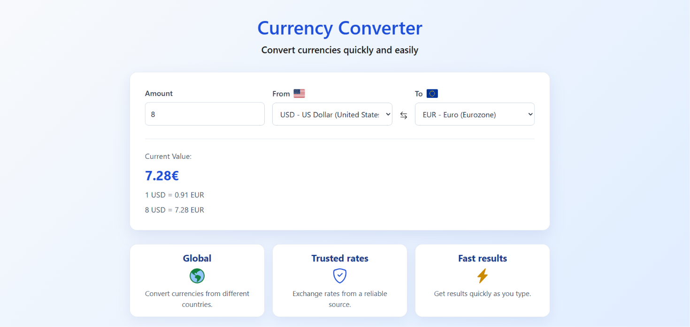
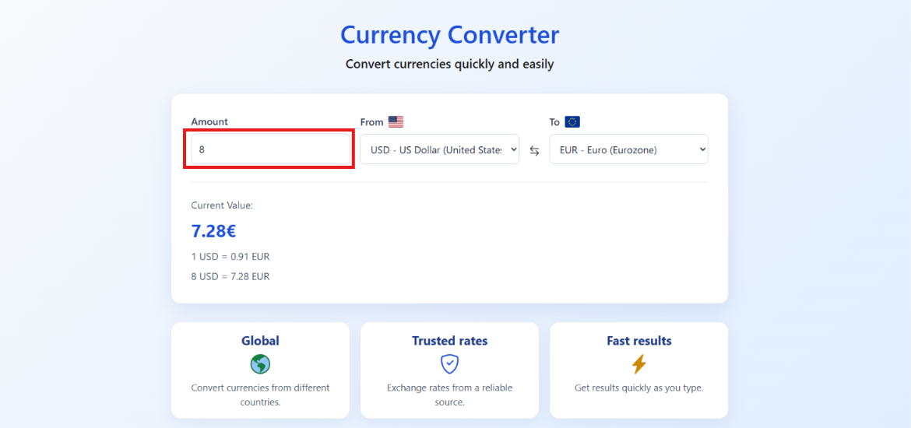
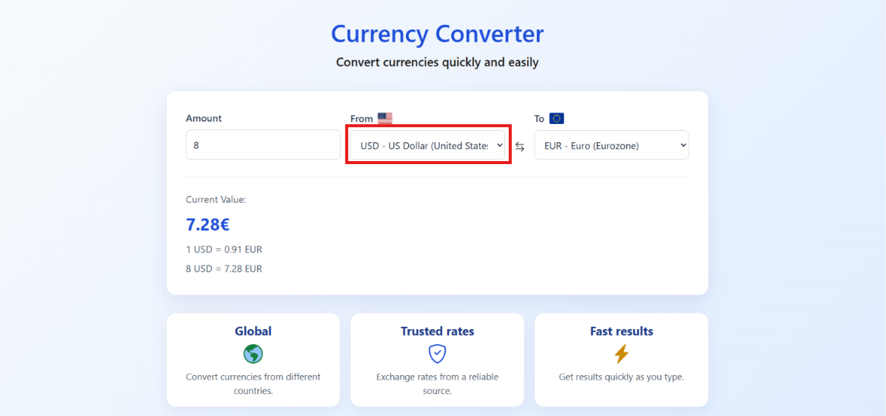
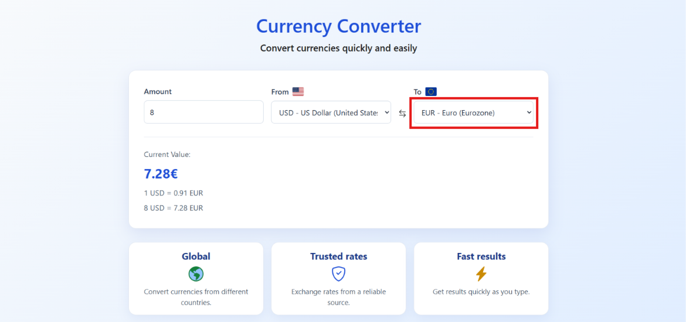
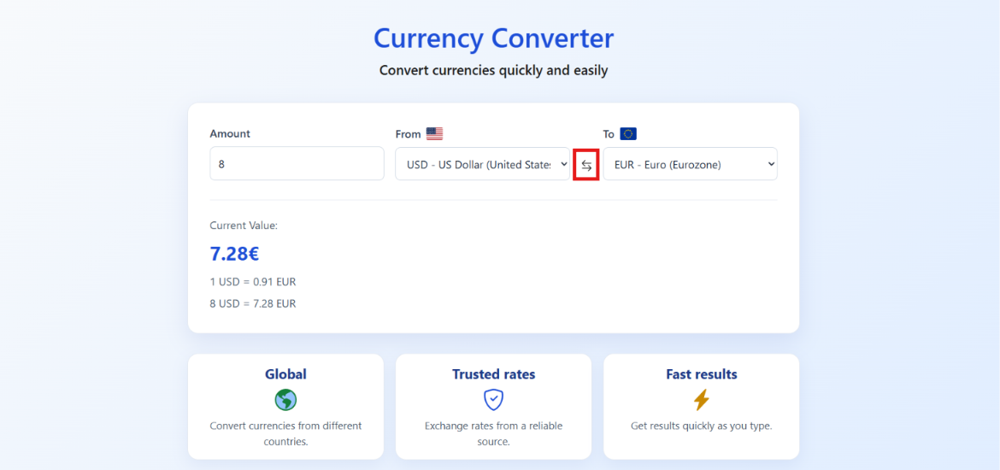
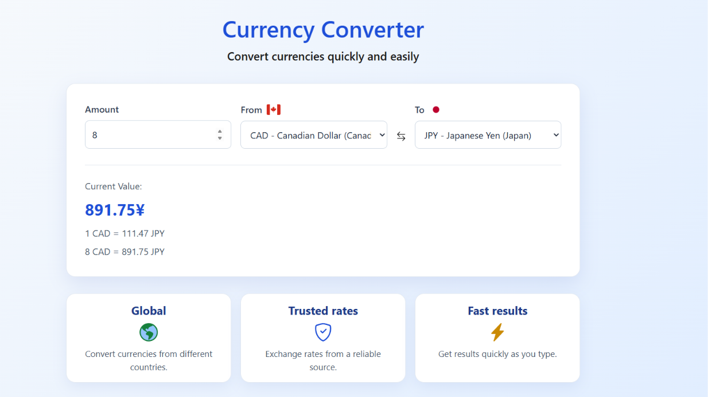

# Currency Converter

Currency Converter is a React, TypeScript, and Redux application that converts
amounts between 12 currencies using European Central Bank (ECB) reference
exchange rates.



## 🌐 Production site

[dailyecbrates.com](http://dailyecbrates.com/)

The application will be published at this address in the future.

## 🧭 How to use the converter

1. **Enter an amount.** Use the Amount field to enter a non-negative number,
   including decimals. The result updates as the amount changes.

   

2. **Choose the original currency.** Select the currency you are converting
   from in the From list.

   

3. **Choose the destination currency.** Select the currency you want to
   receive in the To list. Each selector shows the currency name and country,
   with a flag beside the label.

   

4. **Swap currencies if needed.** Use the arrows between the selectors to
   exchange the From and To currencies.

   

5. **Read the result.** The page displays the converted amount, the exchange
   rate for one unit, and a summary of the conversion. It shows a loading
   message while required rates are being fetched and an error if a request
   fails. Selecting the same currency on both sides keeps the amount unchanged.

   

## 💱 Available currencies

| Code | Currency | Country or region |
| --- | --- | --- |
| USD | US Dollar | United States |
| SGD | Singapore Dollar | Singapore |
| EUR | Euro | Eurozone |
| GBP | Pound Sterling | United Kingdom |
| JPY | Japanese Yen | Japan |
| CAD | Canadian Dollar | Canada |
| AUD | Australian Dollar | Australia |
| CHF | Swiss Franc | Switzerland |
| CNY | Chinese Yuan | China |
| INR | Indian Rupee | India |
| MXN | Mexican Peso | Mexico |
| BRL | Brazilian Real | Brazil |

## 🏦 Exchange rate source

The application requests reference rates from the
[European Central Bank](https://www.ecb.europa.eu/stats/policy_and_exchange_rates/euro_reference_exchange_rates/html/index.en.html).
The ECB normally updates them each working day, excluding weekends and certain
holidays. These are reference rates, not live trading or transaction rates.

The rates use EUR as the base: `1 EUR = 1 EUR`, and other rates express how
many units of a currency equal one euro. The application uses those rates to
calculate conversions between the selected currencies. Available rates are
reused as the amount changes; the current implementation does not check
whether rates for two currencies were published on the same date.

## 🚀 Install and run

You need Node.js and npm installed.

```sh
git clone https://github.com/2020LM/CurrencyConverter.git
cd CurrencyConverter
npm install
npm run dev
```

Open the local URL printed by Vite in your browser.

## 🧪 Tests

Run the Jest test suite:

```sh
npm test
```

## 📦 Production build

Check TypeScript and create the production build in `dist`:

```sh
npm run build
```

To preview the build locally:

```sh
npm run preview
```

## 🔄 Redux data-fetching approaches

This project is intended to compare three ways of requesting ECB data:

- **Redux Thunk:** implemented with a manual thunk that requests the required
  rates and dispatches actions to update the Redux slice.
- **`createAsyncThunk`:** implemented as an alternative using Redux Toolkit's
  generated pending, fulfilled, and rejected actions for each currency.
- **RTK Query:** planned as an alternative using Redux Toolkit's data-fetching
  and caching tools.

The application currently uses the manual Redux Thunk approach. The
`createAsyncThunk` slice is prepared separately and is not active in the UI;
RTK Query is not implemented yet.

## 📄 Licenses

Country flags are from [Flag Icons](https://github.com/lipis/flag-icons);
their license is available in [LICENSE](./src/assets/countries/LICENSE).

## 👤 Author

[Gabriel Oviedo](https://github.com/2020LM)
